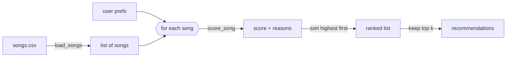

# 🎵 Music Recommender Simulation

## Project Summary

In this project you will build and explain a small music recommender system.

Your goal is to:

- Represent songs and a user "taste profile" as data
- Design a scoring rule that turns that data into recommendations
- Evaluate what your system gets right and wrong
- Reflect on how this mirrors real world AI recommenders

Replace this paragraph with your own summary of what your version does.

---

## How The System Works

Real-world platforms like Spotify and YouTube combine two approaches. **Collaborative filtering** learns from the behavior of millions of users (likes, skips, replays, playlist adds) and recommends what similar listeners enjoyed. **Content-based filtering** looks at the songs themselves (genre, mood, tempo, energy) and recommends tracks that sound like ones you already like. Production systems blend both: they pull a pool of candidates, score each one, then rank and re-rank the list for diversity and freshness. My simulation has no listening history, so it is a purely **content-based** recommender. It prioritizes **mood first**, because I pick music by how I want to feel rather than by genre. **Energy closeness** comes second and genre third. Numeric features are scored by how *close* a song is to the user's target, not by whether the value is higher or lower, so a calm-music listener isn't pushed toward the loudest tracks.

### Features used

**`Song`**
- `genre`: compared to the user's favorite genre
- `mood`: compared to the user's favorite mood
- `energy` (0–1): compared to the user's target energy
- `acousticness` (0–1): compared to the user's acoustic preference
- Stored but not scored: `id`, `title`, `artist`, `tempo_bpm`, `valence`, `danceability`. In this dataset, tempo and danceability track energy very closely, so scoring them would count the same quality twice.

**`UserProfile`**
- `favorite_mood`: the mood the user wants
- `target_energy`: the user's ideal energy level (0–1)
- `favorite_genre`: the user's preferred genre
- `likes_acoustic`: whether the user prefers acoustic songs

### Algorithm recipe

**Scoring Rule** (one song):

| Rule | Points |
|---|---|
| Mood matches `favorite_mood` | +2.0 |
| Energy closeness: `1.5 × (1 − abs(song.energy − target_energy))` | up to +1.5 |
| Genre matches `favorite_genre` | +1.0 |
| Acoustic fit: `0.5 × acousticness` if `likes_acoustic`, else `0.5 × (1 − acousticness)` | up to +0.5 |

**Why mood outweighs genre:** the suggested starting weights (+2.0 genre, +1.0 mood) rank a lofi song in the wrong mood (*Focus Flow*, "focused") above an ambient song with the right mood (*Spacewalk Thoughts*, "chill"). Because I choose music by mood, I flipped the weights. Mood is the main signal, and genre is a tiebreaker bonus.

**Ranking Rule** (all songs): score every song, sort from highest to lowest score (ties broken by energy closeness), and return the top `k` along with the reasons each song earned its points. A diversity penalty (-1.0 per repeated artist, -0.5 per repeated genre) is applied as the list is built, so the top results aren't all the same artist or genre (see Stretch Challenges).

### Data and user profile

- **Catalog:** `data/songs.csv` was expanded from 10 to 18 songs. The 8 new songs add genres (hip-hop, blues, classical, metal, country, r&b, edm, reggae) and moods (confident, sad, melancholic, angry, nostalgic, romantic, euphoric, uplifting) that weren't in the starter file, including low-valence songs, which the original data lacked.
- **Default profile** (in `src/main.py`): a mood-first listener who wants calm, acoustic study music.

  ```python
  {"favorite_mood": "chill", "target_energy": 0.4, "favorite_genre": "lofi", "likes_acoustic": True}
  ```

  In a planning test, this profile ranks *Library Rain* (chill lofi) 1st and *Storm Runner* (intense rock) 15th. An opposite rock/intense/0.9 profile nearly reverses the order, so the recipe can tell the two styles apart.

### Data flow



### Expected biases and limitations

- **Exact-match mood is all-or-nothing.** "Relaxed" and "focused" earn zero mood points for a "chill" user, so a great-fitting song like *Coffee Shop Stories* (relaxed jazz) can rank below weaker matches. Since 14 moods share 18 songs, most users get only one or two mood matches, and the rest of the list is decided by energy alone.
- **Mood-first can override genre dislikes.** A chill-mood song in a genre the user dislikes can still outrank their favorite genre in a different mood. That's intended for discovery, but some users would see it as a miss.
- **The catalog is uneven.** Lofi and "chill" have three songs each, while most genres and moods have one. Lofi or chill listeners get a full, well-matched list, and everyone else gets one good match followed by filler.
- **Energy and acousticness overlap.** In this data they are almost perfect opposites, so `likes_acoustic` mostly repeats the energy preference. This rewards consistent "calm and acoustic" or "loud and electronic" users and slightly penalizes people who like, say, energetic acoustic music.
- **Labels are subjective and strict.** Mood and genre were assigned by hand (and partly generated with AI), and `pop` vs `indie pop` counts as a complete mismatch.
- **No emotional tone or context.** Without valence, the system can't tell calm-happy from calm-sad, and it ignores time of day, activity, lyrics and vocals.
- **No exploration.** The same profile always gets the same list. Unlike real platforms, nothing new or unexpected is ever mixed in, which creates a filter bubble.

---

## Getting Started

### Setup

1. Create a virtual environment (optional but recommended):

   ```bash
   python -m venv .venv
   source .venv/bin/activate      # Mac or Linux
   .venv\Scripts\activate         # Windows

2. Install dependencies

```bash
pip install -r requirements.txt
```

3. Run the app:

```bash
python -m src.main
```

### Running Tests

Run the starter tests with:

```bash
pytest
```

You can add more tests in `tests/test_recommender.py`.

---

## Sample Recommendation Output

Output of `python -m src.main` for the default "Happy Pop" profile and my "Chill Lofi" profile (with the diversity penalty on):

```
Loading songs from data/songs.csv...
Loaded songs: 18

Profile: Happy Pop
  mood=happy  genre=pop  energy=0.8  likes_acoustic=False
+----+--------------------------+-------+------------------------------------------------+
| #  | Song                     | Score | Reasons                                        |
+====+==========================+=======+================================================+
| 1  | Sunrise City             | 4.88  | - mood match: happy (+2.0)                     |
|    | by Neon Echo             |       | - energy 0.82 vs target 0.80 (+1.47)           |
|    | pop / happy              |       | - genre match: pop (+1.0)                      |
|    |                          |       | - electronic sound (+0.41)                     |
+----+--------------------------+-------+------------------------------------------------+
| 2  | Rooftop Lights           | 3.77  | - mood match: happy (+2.0)                     |
|    | by Indigo Parade         |       | - energy 0.76 vs target 0.80 (+1.44)           |
|    | indie pop / happy        |       | - electronic sound (+0.33)                     |
+----+--------------------------+-------+------------------------------------------------+
| 3  | Gym Hero                 | 2.28  | - energy 0.93 vs target 0.80 (+1.30)           |
|    | by Max Pulse             |       | - genre match: pop (+1.0)                      |
|    | pop / intense            |       | - electronic sound (+0.47)                     |
|    |                          |       | - diversity: pop already listed (-0.5)         |
+----+--------------------------+-------+------------------------------------------------+
| 4  | Concrete Crown           | 1.91  | - energy 0.78 vs target 0.80 (+1.47)           |
|    | by Blockwise             |       | - electronic sound (+0.44)                     |
|    | hip-hop / confident      |       |                                                |
+----+--------------------------+-------+------------------------------------------------+
| 5  | Storm Runner             | 1.78  | - energy 0.91 vs target 0.80 (+1.33)           |
|    | by Voltline              |       | - electronic sound (+0.45)                     |
|    | rock / intense           |       |                                                |
+----+--------------------------+-------+------------------------------------------------+
Summary: top pick Sunrise City (4.88 / 5.0) | 5 artists | 4 genres

Profile: Chill Lofi
  mood=chill  genre=lofi  energy=0.4  likes_acoustic=True
+----+--------------------------+-------+------------------------------------------------+
| #  | Song                     | Score | Reasons                                        |
+====+==========================+=======+================================================+
| 1  | Library Rain             | 4.85  | - mood match: chill (+2.0)                     |
|    | by Paper Lanterns        |       | - energy 0.35 vs target 0.40 (+1.42)           |
|    | lofi / chill             |       | - genre match: lofi (+1.0)                     |
|    |                          |       | - acoustic sound (+0.43)                       |
+----+--------------------------+-------+------------------------------------------------+
| 2  | Midnight Coding          | 4.32  | - mood match: chill (+2.0)                     |
|    | by LoRoom                |       | - energy 0.42 vs target 0.40 (+1.47)           |
|    | lofi / chill             |       | - genre match: lofi (+1.0)                     |
|    |                          |       | - acoustic sound (+0.35)                       |
|    |                          |       | - diversity: lofi already listed (-0.5)        |
+----+--------------------------+-------+------------------------------------------------+
| 3  | Spacewalk Thoughts       | 3.78  | - mood match: chill (+2.0)                     |
|    | by Orbit Bloom           |       | - energy 0.28 vs target 0.40 (+1.32)           |
|    | ambient / chill          |       | - acoustic sound (+0.46)                       |
+----+--------------------------+-------+------------------------------------------------+
| 4  | Coffee Shop Stories      | 1.90  | - energy 0.37 vs target 0.40 (+1.46)           |
|    | by Slow Stereo           |       | - acoustic sound (+0.45)                       |
|    | jazz / relaxed           |       |                                                |
+----+--------------------------+-------+------------------------------------------------+
| 5  | Empty Platform           | 1.72  | - energy 0.30 vs target 0.40 (+1.35)           |
|    | by Grey Harbor           |       | - acoustic sound (+0.37)                       |
|    | blues / sad              |       |                                                |
+----+--------------------------+-------+------------------------------------------------+
Summary: top pick Library Rain (4.85 / 5.0) | 5 artists | 4 genres
```

**Does it match expectations?** Yes. For Happy Pop, *Sunrise City* (the only song that is both pop and happy) comes first. *Rooftop Lights* (indie pop, happy) comes second, ahead of *Gym Hero* (pop, intense), because the mood match outweighs the genre match. Note that "indie pop" doesn't count as a pop match, so the exact-match genre rule is strict. Positions 4–5 have no label matches and are ranked by energy closeness alone.

**Screenshot or video** *(optional)*: <!-- Insert a screenshot or demo video link here -->

---

## Stretch Challenges

### Challenge 3: Diversity penalty

**Prompt used:** "In recommend_songs, add a diversity rule so the top k doesn't fill up with the same artist or genre. Build the list one song at a time. Before each pick, subtract 1.0 from a song's score for every song by the same artist already in the list, and 0.5 for every song of the same genre already in the list. Add the penalty to the song's reasons, like 'diversity: LoRoom already listed (-1.0)'. Keep the original ranking available with a diversity=False flag."

**How it works:** `recommend_songs` still scores every song the same way. Then, instead of taking the top 5 straight from the sorted list, it picks one song at a time. Each candidate loses points for repeating an artist (-1.0 each) or a genre (-0.5 each) that's already been picked, and the highest adjusted score wins the next spot. Penalties show up as reasons, so the user can see why a song dropped. `recommend_songs(..., diversity=False)` gives the original ranking.

| Profile | Without diversity | With diversity | Why |
|---|---|---|---|
| Happy Pop | #5 Night Drive Loop | #5 Storm Runner | Night Drive Loop is by Neon Echo, the same artist as #1 |
| Chill Lofi | #4 Focus Flow | #4 Coffee Shop Stories, #5 Empty Platform | Focus Flow would be the 3rd lofi song *and* the 2nd LoRoom song (-2.0) |
| Deep Intense Rock | #5 Sunrise City | #5 Concrete Crown | Sunrise City would be a 2nd pop song after Gym Hero |
| Acoustic Headbanger / Sloppy Input | #5 Sunrise City | #5 Rooftop Lights | Same pop repeat |

**Was it better?** Mostly. Every list now has 4–5 different genres and no repeated artists. The trade-off shows in Chill Lofi: dropping Focus Flow pulled in Empty Platform (sad blues), which fits the energy but not the chill mood. Also, Rooftop Lights is "indie pop," so the genre penalty doesn't treat it as pop. That's the same strict-label problem from the model card.

### Challenge 4: Summary table

**Prompt used:** "Suggest a way to show my top recommendations as a table in the terminal, using tabulate or simple ASCII formatting. The table must include the reasons for each score. Show rank, song (title, artist, genre/mood), score, and every reason on its own line, wrapped so the table stays readable. Add a one-line summary under each table."

**How it works:** I went with plain ASCII instead of `tabulate`, so there's no extra dependency. `print_recommendations` in `src/main.py` builds a bordered table where each cell can hold several lines: song details stack in one column, and each reason gets its own wrapped line. A summary line under each table shows the top pick and how many different artists and genres made the list, which also makes it easy to check the diversity rule. See the sample output above.

---

## Experiments You Tried

- **Weight shift (energy ×2, genre ÷2):** I temporarily changed energy from 1.5 to 3.0 points and genre from 1.0 to 0.5. Five of seven profiles kept the exact same top 5. Chill Lofi's #1 and #2 swapped by 0.01 points, and Unknown Tastes swapped its #5 for a song with closer energy. The results were mostly *different*, not more accurate. The change also made the system more fragile: for "Sad but Hyped," the only sad song's lead shrank from 1.80 to 0.41 points. I reverted to the original weights. Full results are in [model_card.md](model_card.md#7-evaluation).
- **Genre-first vs mood-first (planning):** with the starter weights (genre 2.0, mood 1.0), a chill-lofi user got *Focus Flow* (lofi, "focused") ahead of *Spacewalk Thoughts* (ambient, "chill"). Flipping to mood-first reversed that, which matched how I pick music.
- **Seven user profiles:** three normal and four adversarial (conflicting preferences, unknown labels, sloppy input). Normal profiles behave well. Adversarial ones show that energy takes over when labels don't match, and that capitalized labels or out-of-range energy break the results. See the Evaluation section of [model_card.md](model_card.md#7-evaluation).

---

## Limitations and Risks

Summarize some limitations of your recommender.

Examples:

- It only works on a tiny catalog
- It does not understand lyrics or language
- It might over favor one genre or mood

You will go deeper on this in your model card.

---

## Reflection

Read and complete `model_card.md`:

[**Model Card**](model_card.md)

The main thing I learned is that a recommender doesn't really "know" what you like. It just turns your taste into a few numbers and labels, compares every song against them, and sorts the list. Mine gives points for matching mood, being close to your energy level, matching genre, and sounding acoustic or electronic, and that's it. Still, the results felt surprisingly personal when the profile was clear. What made the biggest difference wasn't fancy math. It was choices I made, like scoring energy by how *close* a song is instead of "higher is better," and deciding mood should matter more than genre because that's how I actually listen.

Bias shows up in places I didn't expect. My catalog has three "chill" songs but only one sad song, one angry song and one romantic song, so if your taste is common you get a great list, and if it's not you get one good match and a bunch of filler. Exact label matching made it worse: a rock fan got a pop workout track over a metal song because the metal song was tagged "angry" instead of "intense." And a tiny typo in your profile could flip your whole list. If that happens with 18 songs, I can only imagine what happens at Spotify's scale, where whatever's overrepresented in the data, or whoever labeled it, quietly shapes what millions of people hear.
