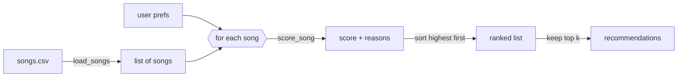

# 🎵 Music Recommender Simulation

## Project Summary

In this project you will build and explain a small music recommender system.

Your goal is to:

- Represent songs and a user "taste profile" as data
- Design a scoring rule that turns that data into recommendations
- Evaluate what your system gets right and wrong
- Reflect on how this mirrors real world AI recommenders

Replace this paragraph with your own summary of what your version does.

---

## How The System Works

Real-world platforms like Spotify and YouTube combine two approaches. **Collaborative filtering** learns from the behavior of millions of users (likes, skips, replays, playlist adds) and recommends what similar listeners enjoyed. **Content-based filtering** looks at the songs themselves (genre, mood, tempo, energy) and recommends tracks that sound like ones you already like. Production systems blend both: they pull a pool of candidates, score each one, then rank and re-rank the list for diversity and freshness. My simulation has no listening history, so it is a purely **content-based** recommender. It prioritizes **mood first**, because I pick music by how I want to feel rather than by genre. **Energy closeness** comes second and genre third. Numeric features are scored by how *close* a song is to the user's target, not by whether the value is higher or lower, so a calm-music listener isn't pushed toward the loudest tracks.

### Features used

**`Song`**
- `genre`: compared to the user's favorite genre
- `mood`: compared to the user's favorite mood
- `energy` (0–1): compared to the user's target energy
- `acousticness` (0–1): compared to the user's acoustic preference
- Stored but not scored: `id`, `title`, `artist`, `tempo_bpm`, `valence`, `danceability`. In this dataset, tempo and danceability track energy very closely, so scoring them would count the same quality twice.

**`UserProfile`**
- `favorite_mood`: the mood the user wants
- `target_energy`: the user's ideal energy level (0–1)
- `favorite_genre`: the user's preferred genre
- `likes_acoustic`: whether the user prefers acoustic songs

### Algorithm recipe

**Scoring Rule** (one song):

| Rule | Points |
|---|---|
| Mood matches `favorite_mood` | +2.0 |
| Energy closeness: `1.5 × (1 − abs(song.energy − target_energy))` | up to +1.5 |
| Genre matches `favorite_genre` | +1.0 |
| Acoustic fit: `0.5 × acousticness` if `likes_acoustic`, else `0.5 × (1 − acousticness)` | up to +0.5 |

**Why mood outweighs genre:** the suggested starting weights (+2.0 genre, +1.0 mood) rank a lofi song in the wrong mood (*Focus Flow*, "focused") above an ambient song with the right mood (*Spacewalk Thoughts*, "chill"). Because I choose music by mood, I flipped the weights. Mood is the main signal, and genre is a tiebreaker bonus.

**Ranking Rule** (all songs): score every song, sort from highest to lowest score (ties broken by energy closeness), and return the top `k` along with the reasons each song earned its points.

### Data and user profile

- **Catalog:** `data/songs.csv` was expanded from 10 to 18 songs. The 8 new songs add genres (hip-hop, blues, classical, metal, country, r&b, edm, reggae) and moods (confident, sad, melancholic, angry, nostalgic, romantic, euphoric, uplifting) that weren't in the starter file, including low-valence songs, which the original data lacked.
- **Default profile** (in `src/main.py`): a mood-first listener who wants calm, acoustic study music.

  ```python
  {"favorite_mood": "chill", "target_energy": 0.4, "favorite_genre": "lofi", "likes_acoustic": True}
  ```

  In a planning test, this profile ranks *Library Rain* (chill lofi) 1st and *Storm Runner* (intense rock) 15th. An opposite rock/intense/0.9 profile nearly reverses the order, so the recipe can tell the two styles apart.

### Data flow



### Expected biases and limitations

- **Exact-match mood is all-or-nothing.** "Relaxed" and "focused" earn zero mood points for a "chill" user, so a great-fitting song like *Coffee Shop Stories* (relaxed jazz) can rank below weaker matches. Since 14 moods share 18 songs, most users get only one or two mood matches, and the rest of the list is decided by energy alone.
- **Mood-first can override genre dislikes.** A chill-mood song in a genre the user dislikes can still outrank their favorite genre in a different mood. That's intended for discovery, but some users would see it as a miss.
- **The catalog is uneven.** Lofi and "chill" have three songs each, while most genres and moods have one. Lofi or chill listeners get a full, well-matched list, and everyone else gets one good match followed by filler.
- **Energy and acousticness overlap.** In this data they are almost perfect opposites, so `likes_acoustic` mostly repeats the energy preference. This rewards consistent "calm and acoustic" or "loud and electronic" users and slightly penalizes people who like, say, energetic acoustic music.
- **Labels are subjective and strict.** Mood and genre were assigned by hand (and partly generated with AI), and `pop` vs `indie pop` counts as a complete mismatch.
- **No emotional tone or context.** Without valence, the system can't tell calm-happy from calm-sad, and it ignores time of day, activity, lyrics and vocals.
- **No exploration.** The same profile always gets the same list. Unlike real platforms, nothing new or unexpected is ever mixed in, which creates a filter bubble.

---

## Getting Started

### Setup

1. Create a virtual environment (optional but recommended):

   ```bash
   python -m venv .venv
   source .venv/bin/activate      # Mac or Linux
   .venv\Scripts\activate         # Windows

2. Install dependencies

```bash
pip install -r requirements.txt
```

3. Run the app:

```bash
python -m src.main
```

### Running Tests

Run the starter tests with:

```bash
pytest
```

You can add more tests in `tests/test_recommender.py`.

---

## Sample Recommendation Output

Output of `python -m src.main` for the default "Happy Pop" profile and my "Chill Lofi" profile:

```
Loading songs from data/songs.csv...
Loaded songs: 18

================================================================
Profile: Happy Pop
  mood=happy  genre=pop  energy=0.8  likes_acoustic=False
================================================================
1. Sunrise City - Neon Echo
   Score: 4.88 / 5.0   (pop, happy)
     - mood match: happy (+2.0)
     - energy 0.82 vs target 0.80 (+1.47)
     - genre match: pop (+1.0)
     - electronic sound (+0.41)

2. Rooftop Lights - Indigo Parade
   Score: 3.77 / 5.0   (indie pop, happy)
     - mood match: happy (+2.0)
     - energy 0.76 vs target 0.80 (+1.44)
     - electronic sound (+0.33)

3. Gym Hero - Max Pulse
   Score: 2.78 / 5.0   (pop, intense)
     - energy 0.93 vs target 0.80 (+1.30)
     - genre match: pop (+1.0)
     - electronic sound (+0.47)

4. Concrete Crown - Blockwise
   Score: 1.91 / 5.0   (hip-hop, confident)
     - energy 0.78 vs target 0.80 (+1.47)
     - electronic sound (+0.44)

5. Night Drive Loop - Neon Echo
   Score: 1.81 / 5.0   (synthwave, moody)
     - energy 0.75 vs target 0.80 (+1.42)
     - electronic sound (+0.39)

================================================================
Profile: Chill Lofi
  mood=chill  genre=lofi  energy=0.4  likes_acoustic=True
================================================================
1. Library Rain - Paper Lanterns
   Score: 4.85 / 5.0   (lofi, chill)
     - mood match: chill (+2.0)
     - energy 0.35 vs target 0.40 (+1.42)
     - genre match: lofi (+1.0)
     - acoustic sound (+0.43)

2. Midnight Coding - LoRoom
   Score: 4.82 / 5.0   (lofi, chill)
     - mood match: chill (+2.0)
     - energy 0.42 vs target 0.40 (+1.47)
     - genre match: lofi (+1.0)
     - acoustic sound (+0.35)

3. Spacewalk Thoughts - Orbit Bloom
   Score: 3.78 / 5.0   (ambient, chill)
     - mood match: chill (+2.0)
     - energy 0.28 vs target 0.40 (+1.32)
     - acoustic sound (+0.46)

4. Focus Flow - LoRoom
   Score: 2.89 / 5.0   (lofi, focused)
     - energy 0.40 vs target 0.40 (+1.50)
     - genre match: lofi (+1.0)
     - acoustic sound (+0.39)

5. Coffee Shop Stories - Slow Stereo
   Score: 1.90 / 5.0   (jazz, relaxed)
     - energy 0.37 vs target 0.40 (+1.46)
     - acoustic sound (+0.45)
```

**Does it match expectations?** Yes. For Happy Pop, *Sunrise City* (the only song that is both pop and happy) comes first. *Rooftop Lights* (indie pop, happy) comes second, ahead of *Gym Hero* (pop, intense), because the mood match outweighs the genre match. Note that "indie pop" doesn't count as a pop match, so the exact-match genre rule is strict. Positions 4–5 have no label matches and are ranked by energy closeness alone.

**Screenshot or video** *(optional)*: <!-- Insert a screenshot or demo video link here -->

---

## Experiments You Tried

Use this section to document the experiments you ran. For example:

- What happened when you changed the weight on genre from 2.0 to 0.5
- What happened when you added tempo or valence to the score
- How did your system behave for different types of users

---

## Limitations and Risks

Summarize some limitations of your recommender.

Examples:

- It only works on a tiny catalog
- It does not understand lyrics or language
- It might over favor one genre or mood

You will go deeper on this in your model card.

---

## Reflection

Read and complete `model_card.md`:

[**Model Card**](model_card.md)

Write 1 to 2 paragraphs here about what you learned:

- about how recommenders turn data into predictions
- about where bias or unfairness could show up in systems like this


